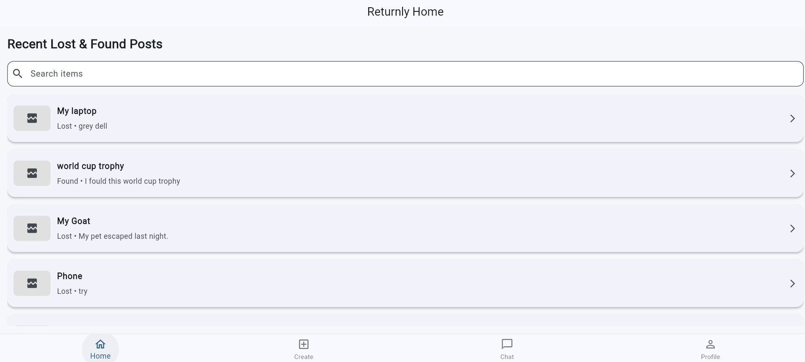
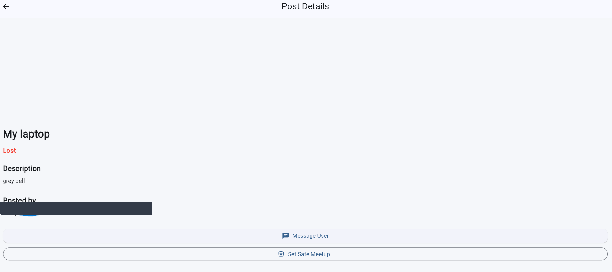
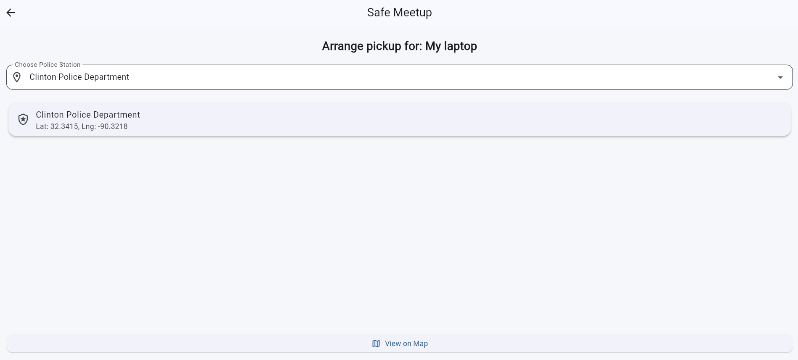
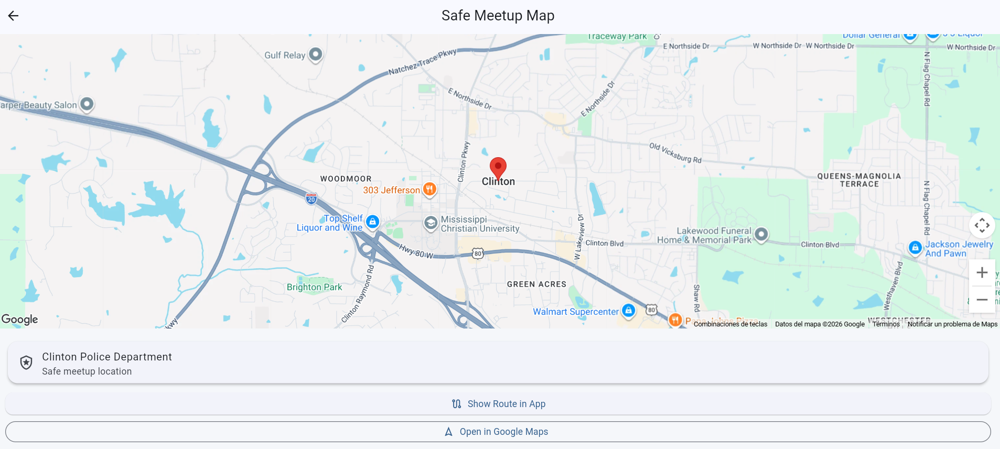
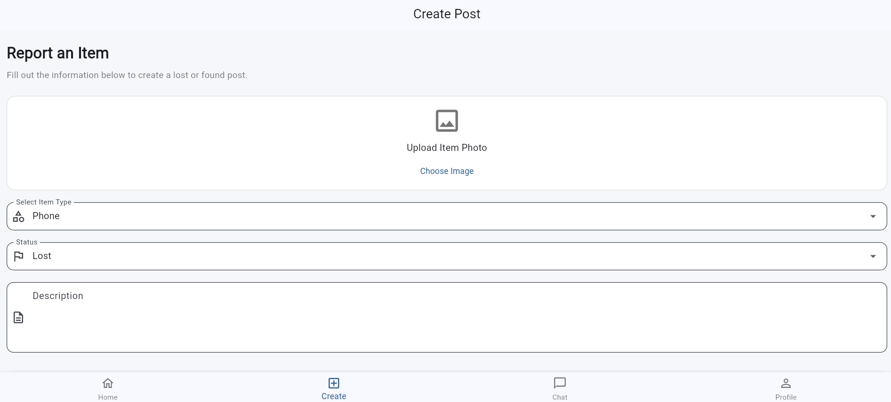
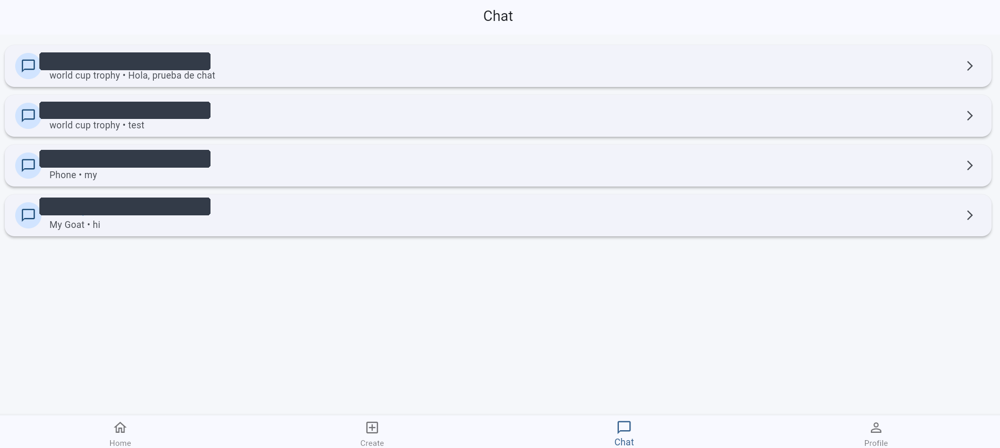
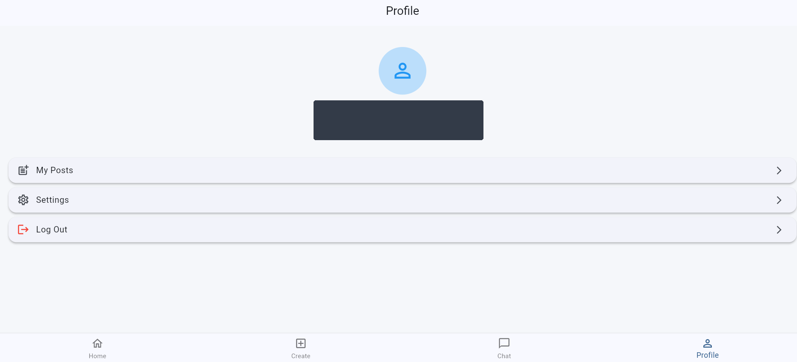
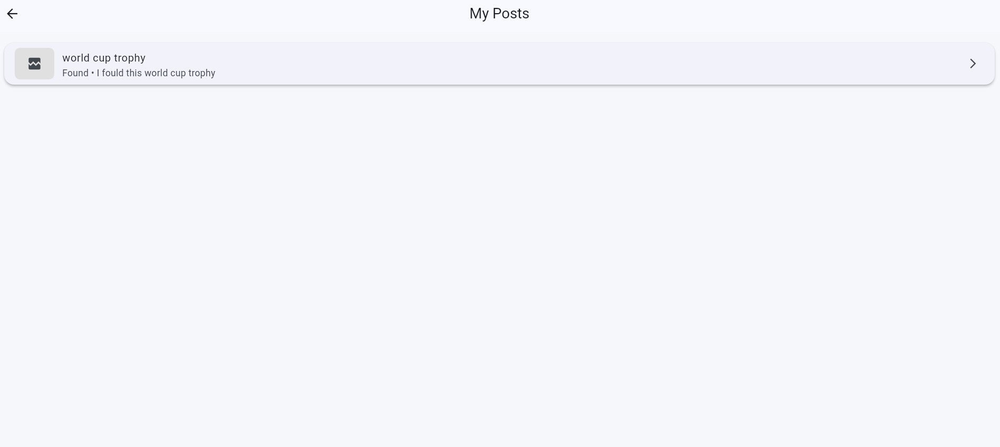
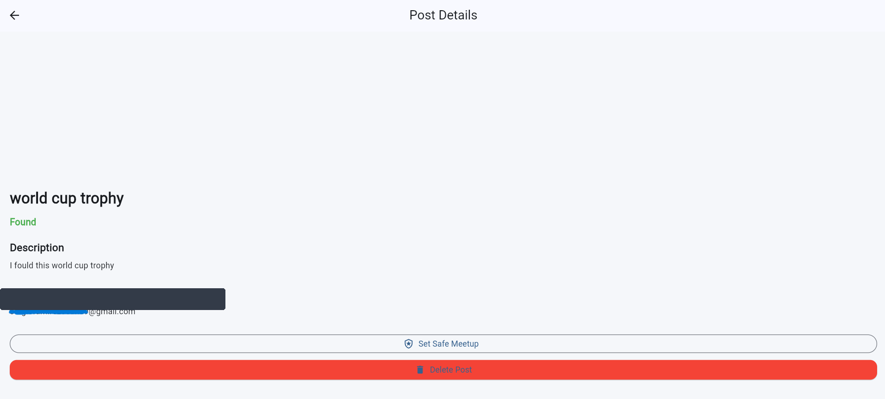
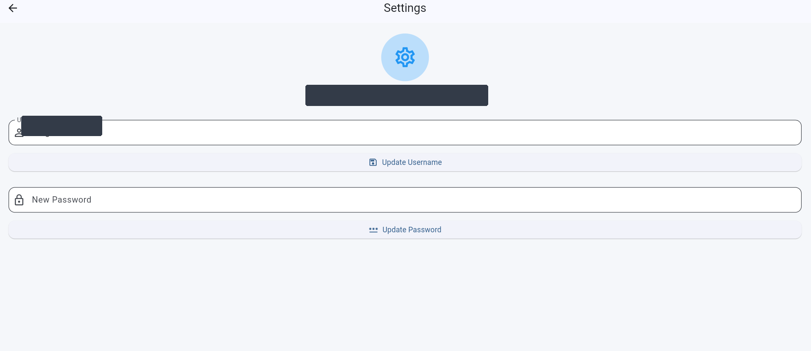

# Returnly — Lost & Found Web Application

**A full-stack web application built with Flutter and Firebase to help people recover lost belongings.**

[**Live Demo**](https://returnly-f592d.web.app) | [**GitHub Repository**](https://github.com/sergiii15/returnly-copy)

## Overview

Returnly is a lost-and-found web application designed to connect people who have lost items with those who have found them.

Users can create and search posts, communicate through real-time messaging, manage their profiles, and coordinate safe meetups at suggested public locations.

This project demonstrates my experience with full-stack application development, user authentication, cloud databases, real-time communication, and third-party API integration.

## Technologies Used

- **Flutter & Dart:** Responsive web interface and application logic.
- **Firebase Authentication:** Secure user registration and login.
- **Cloud Firestore:** Storage of posts, user information, and chat messages.
- **Firebase Hosting:** Web application deployment.
- **Google Maps:** Location selection and safe meetup coordination.
- **Git & GitHub:** Version control and project management.

## Key Features

### User Authentication
Users can create accounts, sign in, and manage their sessions using Firebase Authentication. Phone verification is optional.

### Lost and Found Posts
Users can create posts containing item titles, descriptions, categories, and lost or found status.

### Search Functionality
Users can search through published items to find relevant posts.

### Real-Time Messaging
Firebase Firestore enables users to exchange messages directly within the application.

### Safe Meetup Coordination
Users can coordinate item exchanges at suggested public locations, including police stations, with Google Maps integration.

### User Profiles
Users can view and manage their own posts and access account settings.

## Application Screenshots

### Home Screen


### Post Details


### Safe Meetup


### Meetup Map


### Create Post


### Chat


### User Profile


### My Posts


### Post Management


### Settings


## Project Architecture

The application uses a modular structure that separates the user interface, data models, and backend services.

```text
lib/
├── models/
├── screens/
├── services/
├── widgets/
├── firebase_options.dart
└── main.dart
```

This structure makes the application easier to maintain and extend.

## Current Limitations

Image uploads were implemented using Firebase Cloud Storage. However, image access is currently unavailable because the project's Firebase Storage bucket requires the Blaze pricing plan.

The application remains available for testing its authentication, posts, messaging, and meetup features.

## Future Improvements

- Restore image uploads using a suitable storage solution.
- Improve the responsive interface for mobile devices.
- Expand notification functionality.
- Add more advanced search and filtering options.

## Live Application

**Try Returnly:** https://returnly-f592d.web.app

*Developed as a personal software development project using Flutter, Dart, and Firebase.*
